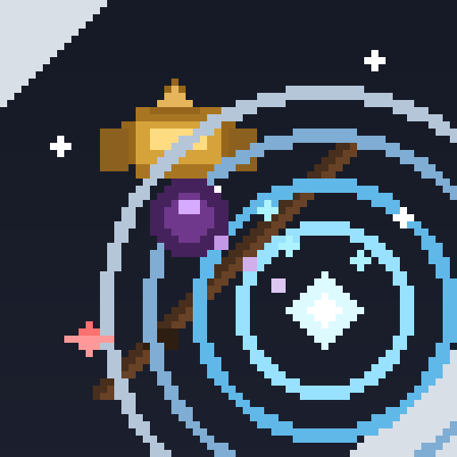

# MasCeffects



Visual PvP effects for **Minecraft: Bedrock Edition**, packaged as a
`.chimerapack` native mod for [GlowberryClient](https://github.com/ChimeraAnt-DEV/GlowberryClient).

This is a re-implementation of the Java Edition mod
[Mas Effect Updated](https://modrinth.com/mod/mas-effect-updated) (an update of
[MasUN0](https://modrinth.com/user/MasUN0)'s [Mas Effects](https://modrinth.com/mod/mas-effects))
for the Bedrock native modding surface.

## What it does

| Effect | Trigger | Notes |
| --- | --- | --- |
| **Mace smash shockwave** | A fast descent that stops | An expanding, fading ring at the landing point. |
| **Ender pearl trail** | A sudden large displacement | A ribbon from the origin to the destination. |
| **Player death effect** | A tracked player's health reaching zero | A burst plus a rising marker, mirroring the Java mod's death skull. |
| **Custom hitboxes** | Every entity the game renders | Colour, opacity, distance fade, and per-kind opacity. |
| **Impact burst** | Same displacement as the trail | A deterministic particle burst at the origin. |
| **Status HUD** | Always (when enabled) | Live effect count, event counters and diagnostics. |

Every effect is configurable from the client's in-game Mod Menu: colours,
lifetimes, radii, tessellation, fade distances, and the thresholds that decide
what counts as a smash, a teleport or a death. Settings persist to
`config/config.json` and survive a restart.

## How this differs from the Java mod

The Java mod hooks Java Edition's damage, impact and death events and reads its
entity list directly. Bedrock's preloader SDK exposes a different surface, so
this port reaches the same features through the seams Bedrock does have. What it
does *not* do is invent data: where a reading cannot be verified, the effect
fails closed and the diagnostics say so.

**What the SDK provides** (`preloader-android/include/pl`):

- `pl::render::RegisterRenderCallback` — a per-frame callback on the render
  thread with the GL context current, plus camera matrices and viewport size.
- `pl::render::ReadLocalPlayerPosition` / `ReadLocalPlayerRotation` — the local
  player's world position and view angles.
- `pl::cosmetics::ResolveGles` — a resolved GLES 2.0 function table.
- `pl::modmenu::*` — Mod Menu modules, config entries, buttons and 2D HUD draw
  commands.
- `pl::memory::hook` — detours that **chain** onto an existing target rather
  than replacing it, plus RTTI/vtable and memory-region helpers.

**How the hitboxes work, and why no entity list is needed.** The Java mod's
hitbox mixin hooks `EntityRenderDispatcher::renderHitbox`, which the game calls
once per entity as it renders, passing the entity in. The game already iterates
the entities and tells the hook about each one. Bedrock's equivalent is the
actor render path, and this port reaches it the same way: a detour on the
**verified** `LivePlayerRenderer` entry (the preloader's own hook point, chained
onto rather than replaced) captures each actor pointer as it goes past, reads its
position and box, and draws the hitbox. No entity list is walked anywhere.

**How the death effect works.** The Java mod watches `player.deathTime`. Bedrock
has no death event, so health is read off each captured entity and a drop from a
plausible positive reading to zero is a death — the same inference the client's
own `DeathWatcher` uses for its replay trigger. The effect is a burst plus a
rising marker in place of the Java mod's skull sprite, because the preloader
exposes no particle or sprite path.

**What it still cannot do**, and says so:

- **No per-entity colour rules by owner.** The Java mod colours a hitbox by who
  threw a pearl. That needs an owner relationship and an item-type read the
  preloader does not expose, so hitboxes are coloured by kind (player / mob /
  self) instead.
- **No projectile-specific boxes.** End pearls and wind charges are not
  distinguished, for the same reason.
- **No engine particles.** Effects are world-space `GL_LINES` drawn through the
  render callback using the game's own camera matrix.
- **No server-confirmed anything.** Every trigger is a client-side inference.
  Nothing here affects gameplay, damages anyone, or reads server state.

There is no Java Edition runtime involved anywhere: this is native C++ compiled
for `arm64-v8a`, loaded by the preloader.

### What is verified, and what is gated

The entity feed reads `Actor` fields whose offsets the preloader documents and
uses for its own local-player feed. It is still the part that must be right or
not run at all, so it is gated at every step:

- The detour resolves its target by the diagnostic string the function body
  references (falling back to the verified slot index the client ships), and
  refuses an address that is not executable code.
- A captured pointer is only accepted when it reads as a real polymorphic object
  with a well-formed RTTI name and a finite world position. A register holding a
  matrix or a counter is rejected.
- A health reading that is not finite is reported, not used, so a wrong offset
  cannot look like a live player.
- The feed installs separately from the render callback, so a build where it
  cannot resolve loses only the hitboxes and the death effect. The shockwave,
  trail and status HUD keep working.

If the feed is unavailable the status HUD reports `feed: inactive (<reason>)`,
and the rejected-reading count is on the diagnostics line, so a wrong offset is
visible rather than silent.

## Layout

```text
MasCeffects/
├── CMakeLists.txt              host tests + Android mod library
├── manifest.json               preload-native manifest
├── scripts/build-chimerapack.sh
├── src/
│   ├── EffectMath.{hpp,cpp}    pure maths: colours, detectors, geometry
│   ├── EffectEngine.{hpp,cpp}  live effect list, render-tick keyed
│   ├── GameFeed.{hpp,cpp}      entity + health capture from the game
│   ├── WorldRenderer.{hpp,cpp} GLES line pipeline with state save/restore
│   ├── HudOverlay.{hpp,cpp}    2D status readout
│   ├── MasEffectConfig.hpp     typed persisted config + schema
│   └── MasCeffectsMod.{hpp,cpp} lifecycle, Mod Menu, render callback
├── tests/EffectMathTest.cpp    host unit tests
└── tools/GenerateConfig.cpp    packaged default config generator
```

The split matters: everything in `EffectMath` is free of Android, GLES and the
preloader, so the rules that are easy to get wrong without a device — the smash
and teleport detectors, the colour parser, the fade curves, the hitbox distance
fade, the tessellation clamps — are covered by host unit tests that run before
anything is packaged. `GameFeed` is the only file that touches game memory, and
it is deliberately the smallest thing that can work.

## Building

Requirements: CMake 3.22+, Ninja, a C++20 compiler, Python 3, and the Android
NDK (r28 recommended).

```sh
# Point at a preloader-android checkout (or vendor it at
# app/src/main/cpp/preloader, the submodule path the client uses).
export PRELOADER_ROOT=/path/to/preloader-android
export ANDROID_NDK_HOME=/path/to/android-ndk

./scripts/build-chimerapack.sh --clean
```

Output:

```text
dist/arm64-v8a/masceffects/
dist/arm64-v8a/masceffects.chimerapack
```

The script runs the host tests first, so a broken effect rule fails the build
rather than reaching a package.

### Host tests only

```sh
cmake -S . -B build/host -G Ninja -DCMAKE_BUILD_TYPE=Release \
      -DPRELOADER_ANDROID_ROOT=/path/to/preloader-android
cmake --build build/host
./build/host/masc_effect_tests
```

## Installing

Import `masceffects.chimerapack` through GlowberryClient's mod import flow. The
package is a ZIP whose root holds `manifest.json`, `libmasceffects.so` and
`config/`, which is the layout the importer validates.

### Client version requirement

This mod is built against the preloader SDK API that shipped in GlowberryClient
builds after **OV.2** (the preloader gained the `pl::render` callback API on
2026-10-11). On OV.2 the mod **will not load**: the installed `libpreloader.so`
does not export the `pl::render`, `pl::cosmetics::GlesBackend`/`LastGlesError`
and `pl::memory::isExecutableAddress` symbols the mod imports, and the loader
aborts it with *"Built for a different game build (missing symbol)"*.

Use a GlowberryClient build whose bundled preloader includes these exports —
current `main` does (preloader submodule `72b5a7c`). **Minecraft version is not
the problem**: an empty `minecraft_versions` manifest means "all versions", and
the verified version range covers 1.26 through 26.52+. The failure on OV.2 is a
client/preloader SDK version mismatch, not a game-version gate.

If you still see the missing-symbol error on a newer client, run
`scripts/check-symbols.sh` against the `libpreloader.so` bundled in your
installed APK (`lib/arm64-v8a/libpreloader.so`) to name the offending symbols.

### Load-safety: one C++ runtime, one exported symbol

The preloader loads mods with `dlopen(RTLD_NOW | RTLD_GLOBAL)` and itself links
the **shared** libc++ (`libc++_shared.so`, which ships in the client APK). Two
build choices keep the mod from colliding with that:

- **`-DANDROID_STL=c++_shared`**: the mod links the *same* shared libc++ the
  preloader uses instead of statically embedding a second copy. A statically
  embedded libc++ that then exports its symbols would land hundreds of
  `std::__ndk1::*`/`fmt::*` symbols in the process-global scope (`RTLD_GLOBAL`),
  interpose over the preloader's own runtime, and can produce the misleading
  *"missing symbol"* load failure even when every `pl::` import is correct.
- **Hidden visibility + `--exclude-libs`**: the mod only exports its single
  public contract symbol, `PLGetModRegistration`. Everything else is library
  internal and stays out of the global symbol table.

You can verify a build is clean before shipping:

```sh
# Only these should be exported by libmasceffects.so (plus the data/rodata it
# needs): PLGetModRegistration. A fat blob of std::/fmt symbols means the build
# statically embedded libc++.
readelf -W --dyn-syms libmasceffects.so | awk '$7!="UND" && $4=="FUNC" {print $8}'
```

`check-symbols.sh` already converts "imports not exported" into a build failure;
this is the complementary check that the mod does not *export* a second runtime.

## Verifying it is live

The mod fails closed and says so rather than guessing. After importing:

1. Open the Mod Menu and confirm the **Mas Effects** module is listed.
2. Turn on **Diagnostics**. The status HUD then reports:
   - `render seam: live` — the per-frame render callback is firing. If this
     reads `inactive`, the preloader did not expose the render seam on this
     build and nothing will be drawn.
   - `feed: live (hook installed (slot N))` — the entity feed resolved and is
     capturing. If it reads `inactive`, hitboxes and the death effect are off
     and the reason is named.
   - `entities:` — how many entity captures have happened. A non-zero, climbing
     number is direct proof the feed works.
   - `pipeline: ready` — the shader and vertex buffer compiled.
   - `gl:` — the backend the SDK resolved (`gles`, `vulkan` or `unknown`).
   - `tick:` and `glerr:` — the frame counter and the last GL error.
3. Press the **Smash** button to spawn a shockwave at your position. This is the
   quickest way to confirm the whole pipeline works without jumping off
   anything.
4. Jump off a block to see the smash shockwave, and throw an ender pearl (or
   make any large displacement) to see the trail and burst.
5. Stand near another player or a mob: their hitbox appears and fades with
   distance, per the fade settings.

If the status HUD shows `render seam: inactive`, the game's player-render hook
did not resolve on that build. That is the documented fail-closed behaviour:
the mod draws nothing and the game runs exactly as it did without it.

## Licence and credit

The original mod's ideas, visuals and description belong to
[MasUN0](https://modrinth.com/user/MasUN0). This port recreates the effects on a
different platform and does not redistribute any Java Edition code or assets.
